# 基于微信小程序的足浴城消费系统

> 🎓 **计算机毕业设计 · 基于微信小程序的足浴城消费系统**
>
> 本仓库只放**项目介绍 + 运行截图**（截图是站点带水印的原图，存在仓库 `images/` 里）。
>
> 👉 **完整可运行源码 / 数据库脚本 / 部署文档：[点我获取](https://geekcode.top/archives/%E5%9F%BA%E4%BA%8E%E5%BE%AE%E4%BF%A1%E5%B0%8F%E7%A8%8B%E5%BA%8F%E7%9A%84%E8%B6%B3%E6%B5%B4%E5%9F%8E%E6%B6%88%E8%B4%B9%E7%B3%BB%E7%BB%9F?utm_source=github)**
>
> 💬 咨询微信：**ir9372**　|　🌐 更多项目：[极客代码 geekcode.top](https://geekcode.top/?utm_source=github)
>
> 📌 项目详情页：<https://geekcode.top/archives/%E5%9F%BA%E4%BA%8E%E5%BE%AE%E4%BF%A1%E5%B0%8F%E7%A8%8B%E5%BA%8F%E7%9A%84%E8%B6%B3%E6%B5%B4%E5%9F%8E%E6%B6%88%E8%B4%B9%E7%B3%BB%E7%BB%9F?utm_source=github>

<table><td width="230" align="center"> <b>扫码加微信 ir9372</b></td><td valign="middle">📦 源码 = 项目介绍 + 全部运行截图 + 数据库 + 部署文档 👉 点上方任意截图，直接跳到 <b>极客代码 geekcode.top</b> 详情页</td></table>

---

<h1>基于微信小程序的足浴城消费系统</h1>
<h2>项目概述</h2>

本项目名为“基于微信小程序的足浴城消费系统”，旨在构建一个集前台用户服务与后台管理于一体的综合性足浴行业数字化解决方案。系统核心功能涵盖商品信息管理、技师信息展示、包厢预约、会员卡申请与管理、购买记录追踪及项目订单处理等模块。适用人群包括足浴城消费者（通过微信小程序端进行浏览、下单、评价）以及足浴城管理人员（通过Web后台或小程序管理端进行数据维护、审核及运营监控）。技术架构采用前后端分离模式，后端基于Spring Boot框架结合MyBatis-Plus和Druid连接池实现高效的数据持久化与业务逻辑处理，前端包含Vue集成的管理后台界面及原生微信小程序客户端，确保多终端适配与良好的用户体验。

<h2>技术架构</h2>

本系统采用成熟的前后端分离架构设计，以确保系统的可扩展性、可维护性及高性能。

<strong>1. 后端架构</strong>
后端服务基于Java语言开发，核心框架选用Spring Boot，利用其自动配置特性简化开发流程。具体技术选型如下：

<ul>
<li><strong>Web层</strong>：使用<code>spring-web</code>和<code>spring-webmvc</code>处理HTTP请求与响应，提供RESTful API接口。</li>
<li><strong>业务层</strong>：依托<code>spring-core</code>、<code>spring-context</code>、<code>spring-aop</code>及<code>spring-tx</code>实现依赖注入、面向切面编程及事务管理，保证业务逻辑的原子性与一致性。</li>
<li><strong>数据访问层</strong>：集成<code>spring-jdbc</code>与<code>MyBatis-Plus</code>，后者作为ORM框架极大简化了CRUD操作，支持条件构造器与分页插件，提升开发效率。</li>
<li><strong>数据库连接</strong>：采用<code>Druid</code>作为数据库连接池，提供强大的监控功能和高性能的连接管理，保障高并发下的稳定性。</li>
<li><strong>测试支持</strong>：引入<code>junit</code>进行单元测试，确保代码质量。</li>
</ul>

<strong>2. 前端架构</strong>

<ul>
<li><strong>管理后台</strong>：采用Vue.js框架构建单页应用（SPA），通过路由配置实现不同功能模块的动态加载。后台路由覆盖了资讯、会员、商品、评论、商家、用户、分类、包厢、技师、配置、购买及订单管理等核心业务页面。</li>
<li><strong>微信小程序端</strong>：作为用户交互的主要入口，小程序端实现了从登录注册、首页浏览、详情查看到订单支付的全链路闭环。同时，小程序内嵌入了部分管理端功能（如用户、商家、商品分类、会员卡的管理视图），方便移动端即时管理。</li>
</ul>

<strong>3. 数据库设计要点</strong>
数据库主要围绕足浴业务实体建模，核心表结构包括：

<ul>
<li><strong>基础信息类</strong>：<code>yonghu</code>（用户）、<code>shangjia</code>（商家）、<code>config</code>（系统配置）。</li>
<li><strong>业务资源类</strong>：<code>shangpinxinxi</code>（商品信息）、<code>baoxiangxinxi</code>（包厢信息）、<code>jishixinxi</code>（技师信息）、<code>shangpinfenlei</code>（商品分类）。</li>
<li><strong>交易与服务类</strong>：<code>goumaixinxi</code>（购买信息）、<code>xiangmudingdan</code>（项目订单）、<code>huiyuanka</code>（会员卡）、<code>huiyuankashenqing</code>（会员卡申请）。</li>
<li><strong>互动与资讯类</strong>：<code>news</code>（公告资讯）、<code>discussbaoxiangxinxi</code>（包厢评论）、<code>discussjishixinxi</code>（技师评论）、<code>discussshangpinxinxi</code>（商品评论）。</li>
</ul>
<h2>功能模块</h2>

根据源码Controller列表及截图所示，系统功能划分为以下主要模块：

<strong>1. 前台用户端（微信小程序）</strong>

<ul>
<li><strong>账户体系</strong>：支持用户注册、登录、忘记密码重置及个人信息的查看与维护。</li>
<li><strong>首页与资讯</strong>：展示系统公告资讯，提供快速入口导航。</li>
<li><strong>商品与服务浏览</strong>：</li>
<li><strong>商品信息</strong>：查看商品列表及详细信息。</li>
<li><strong>技师信息</strong>：查看技师列表、详情及对技师的评价。</li>
<li><strong>包厢信息</strong>：查看包厢列表、详情及对包厢的使用体验评价。</li>
<li><strong>交易流程</strong>：</li>
<li><strong>购买信息</strong>：查看历史购买记录及详情。</li>
<li><strong>项目订单</strong>：生成并管理足浴服务项目的订单状态。</li>
<li><strong>支付确认</strong>：在订单详情页完成支付确认操作。</li>
<li><strong>会员服务</strong>：提交会员卡申请，查看申请进度及详情。</li>
</ul>

<strong>2. 后台管理端（Web + 小程序管理视图）</strong>

<ul>
<li><strong>内容管理</strong>：</li>
<li><strong>公告资讯</strong>：发布、编辑和管理新闻公告。</li>
<li><strong>评论管理</strong>：审核和管理针对包厢、技师、商品的各类用户评论。</li>
<li><strong>基础数据管理</strong>：</li>
<li><strong>用户管理</strong>：查看注册用户列表及详细信息。</li>
<li><strong>商家管理</strong>：维护入驻或关联商家信息。</li>
<li><strong>商品分类</strong>：设置和管理商品所属类别。</li>
<li><strong>系统配置</strong>：修改全局参数配置。</li>
<li><strong>业务对象管理</strong>：</li>
<li><strong>商品信息</strong>：上架、下架及编辑商品详情。</li>
<li><strong>包厢信息</strong>：管理包厢资源状态。</li>
<li><strong>技师信息</strong>：录入和维护技师档案。</li>
<li><strong>交易与会员管理</strong>：</li>
<li><strong>会员卡管理</strong>：发行、停用及管理会员卡信息。</li>
<li><strong>会员卡申请</strong>：审核用户的办卡申请。</li>
<li><strong>购买信息</strong>：查询所有购买记录。</li>
<li><strong>项目订单</strong>：监控和处理项目订单状态。</li>
</ul>
<h2>用户角色与权限</h2>

系统主要涉及两类角色，其权限边界清晰：

<strong>1. 普通用户（消费者）</strong>

<ul>
<li><strong>访问范围</strong>：仅限微信小程序前台界面。</li>
<li><strong>核心权限</strong>：</li>
<li><strong>浏览</strong>：查看公告、商品、技师、包厢信息及对应评论。</li>
<li><strong>交互</strong>：对技师、包厢、商品发表评论；提交会员卡申请。</li>
<li><strong>交易</strong>：创建项目订单，查看购买记录和订单详情，执行支付确认。</li>
<li><strong>个人中心</strong>：管理个人信息，查看自己的申请和订单状态。</li>
<li><strong>限制</strong>：无法访问后台管理路由，无法直接修改基础数据（如商品、技师信息），仅能对自己产生的数据进行操作。</li>
</ul>

<strong>2. 管理员（运营人员）</strong>

<ul>
<li><strong>访问范围</strong>：Web后台管理系统及部分嵌入小程序的管理端视图。</li>
<li><strong>核心权限</strong>：</li>
<li><strong>全量数据管理</strong>：拥有对所有业务实体（用户、商家、商品、分类、包厢、技师、会员卡）的增删改查权限。</li>
<li><strong>内容审核与控制</strong>：管理公告资讯发布，审核并管理所有类型的评论（包厢、技师、商品），确保社区环境健康。</li>
<li><strong>业务流程监管</strong>：处理会员卡申请审批，监控购买信息和项目订单的整体状态，配置系统参数。</li>
<li><strong>视角差异</strong>：在小程序管理端视图中，管理员可查看用户列表、商家列表、商品分类列表及会员卡的详细管理界面，具备移动端办公能力。</li>
</ul>
<h2>项目特色与创新点</h2>

<strong>1. 双端融合的管理体验</strong>
不同于传统系统仅依赖PC后台，本项目在微信小程序中创新性地集成了“管理端”视图（如截图中的“小程序-管理端-用户列表/商家列表/会员卡列表”等）。这使得管理者无需打开电脑即可通过手机随时查看关键业务数据、审核会员申请或监控订单状态，极大地提升了运营的灵活性和响应速度。

<strong>2. 精细化的互动评价体系</strong>
系统设计了独立的评论模块，分别针对“包厢”、“技师”和“商品”三个核心维度（对应Controller: <code>Discussbaoxiangxinxi</code>, <code>Discussjishixinxi</code>, <code>Discussshangpinxinxi</code>）。这种细分的评价机制有助于足浴城精准收集用户对硬件设施、服务质量及售卖产品的反馈，为优化经营策略提供多维度的数据支撑。

<strong>3. 完整的会员生命周期管理</strong>
涵盖了从“会员卡申请”（<code>Huiyuankashenqing</code>）到“会员卡发放与管理”（<code>Huiyuanka</code>）的完整闭环。不仅支持线上申请，还允许后台审核，确保了会员数据的真实性和可控性，强化了客户留存能力。

<strong>4. 稳健的技术栈选型</strong>
采用MyBatis-Plus替代传统MyBatis，大幅减少了样板代码，提高了开发效率；配合Druid连接池，提供了生产级的数据库监控能力，保障了系统在并发场景下的稳定性和可观测性。

<h2>部署环境</h2>

为确保系统正常运行，需准备以下软硬件环境：

<strong>1. 服务端环境</strong>

<ul>
<li><strong>操作系统</strong>：Windows Server, Linux (CentOS/Ubuntu) 或 macOS。</li>
<li><strong>JDK版本</strong>：建议 JDK 1.8 或更高版本（兼容Spring Boot主流版本）。</li>
<li><strong>数据库</strong>：MySQL 5.7 或 MySQL 8.0+，需初始化相应的表结构（用户、商品、订单等）。</li>
<li><strong>构建工具</strong>：Maven 3.6+，用于依赖管理和项目打包。</li>
</ul>

<strong>2. 前端环境</strong>

<ul>
<li><strong>Node.js</strong>：建议 LTS 版本（如 v14.x 或 v16.x），用于编译和运行 Vue 管理后台项目。</li>
<li><strong>包管理器</strong>：npm 或 yarn。</li>
</ul>

<strong>3. 客户端环境</strong>

<ul>
<li><strong>微信开发者工具</strong>：最新版本，用于调试和预览微信小程序代码。</li>
<li><strong>真机设备</strong>：安装微信App的Android或iOS智能手机，用于最终的用户体验测试。</li>
</ul>

<strong>4. 网络要求</strong>

<ul>
<li>服务器需开放相应端口（通常为8080或自定义端口），并确保域名已备案且配置HTTPS证书（微信小程序强制要求合法域名使用HTTPS）。</li>
</ul>
<h2>五、技术特性</h2>
<ul>
<li>前后端集成部署，前端资源打包至后端 static 目录</li>
<li>使用 MyBatis-Plus 简化数据访问层开发</li>
</ul>
<h2>六、功能模块截图</h2>
<h3>前台用户端</h3>
<h4>前台首页框架</h4>

<h3>微信小程序用户端</h3>

<figure><a href="https://geekcode.top/archives/%E5%9F%BA%E4%BA%8E%E5%BE%AE%E4%BF%A1%E5%B0%8F%E7%A8%8B%E5%BA%8F%E7%9A%84%E8%B6%B3%E6%B5%B4%E5%9F%8E%E6%B6%88%E8%B4%B9%E7%B3%BB%E7%BB%9F?utm_source=github" title="查看完整源码">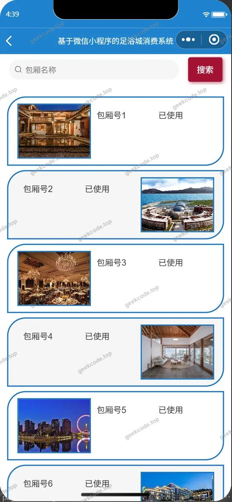</a><figcaption>小程序-包厢信息列表</figcaption></figure>
<figure><a href="https://geekcode.top/archives/%E5%9F%BA%E4%BA%8E%E5%BE%AE%E4%BF%A1%E5%B0%8F%E7%A8%8B%E5%BA%8F%E7%9A%84%E8%B6%B3%E6%B5%B4%E5%9F%8E%E6%B6%88%E8%B4%B9%E7%B3%BB%E7%BB%9F?utm_source=github" title="查看完整源码">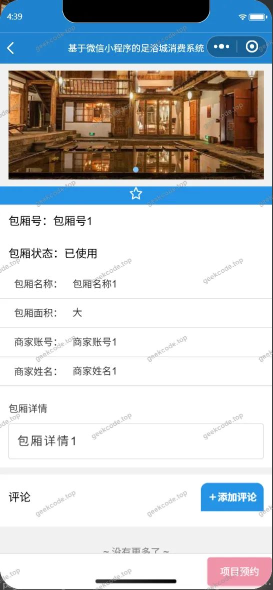</a><figcaption>小程序-包厢信息详情</figcaption></figure>
<figure><figcaption>小程序-登录</figcaption></figure>
<figure><figcaption>小程序-个人信息</figcaption></figure>
<figure><a href="https://geekcode.top/archives/%E5%9F%BA%E4%BA%8E%E5%BE%AE%E4%BF%A1%E5%B0%8F%E7%A8%8B%E5%BA%8F%E7%9A%84%E8%B6%B3%E6%B5%B4%E5%9F%8E%E6%B6%88%E8%B4%B9%E7%B3%BB%E7%BB%9F?utm_source=github" title="查看完整源码">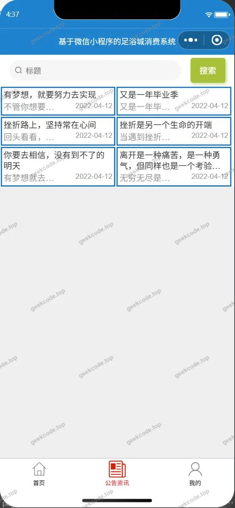</a><figcaption>小程序-公告资讯</figcaption></figure>
<figure><figcaption>小程序-购买信息列表</figcaption></figure>
<figure><figcaption>小程序-购买信息详情</figcaption></figure>
<figure><a href="https://geekcode.top/archives/%E5%9F%BA%E4%BA%8E%E5%BE%AE%E4%BF%A1%E5%B0%8F%E7%A8%8B%E5%BA%8F%E7%9A%84%E8%B6%B3%E6%B5%B4%E5%9F%8E%E6%B6%88%E8%B4%B9%E7%B3%BB%E7%BB%9F?utm_source=github" title="查看完整源码">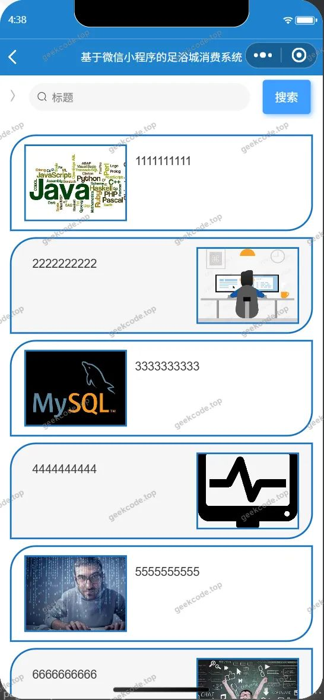</a><figcaption>小程序-会员卡申请列表</figcaption></figure>
<figure><figcaption>小程序-会员卡申请详情</figcaption></figure>
<figure><figcaption>小程序-技师信息列表</figcaption></figure>
<figure><figcaption>小程序-技师信息详情</figcaption></figure>
<figure><figcaption>小程序-商品信息列表</figcaption></figure>
<figure><figcaption>小程序-商品信息详情</figcaption></figure>
<figure><figcaption>小程序-首页</figcaption></figure>
<figure><figcaption>小程序-忘记密码</figcaption></figure>
<figure><a href="https://geekcode.top/archives/%E5%9F%BA%E4%BA%8E%E5%BE%AE%E4%BF%A1%E5%B0%8F%E7%A8%8B%E5%BA%8F%E7%9A%84%E8%B6%B3%E6%B5%B4%E5%9F%8E%E6%B6%88%E8%B4%B9%E7%B3%BB%E7%BB%9F?utm_source=github" title="查看完整源码">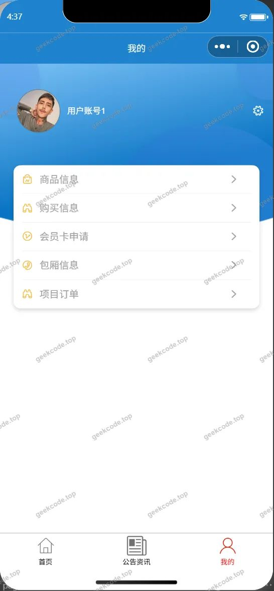</a><figcaption>小程序-我的</figcaption></figure>
<figure><a href="https://geekcode.top/archives/%E5%9F%BA%E4%BA%8E%E5%BE%AE%E4%BF%A1%E5%B0%8F%E7%A8%8B%E5%BA%8F%E7%9A%84%E8%B6%B3%E6%B5%B4%E5%9F%8E%E6%B6%88%E8%B4%B9%E7%B3%BB%E7%BB%9F?utm_source=github" title="查看完整源码">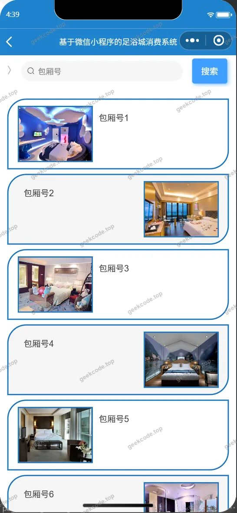</a><figcaption>小程序-项目订单列表</figcaption></figure>
<figure><a href="https://geekcode.top/archives/%E5%9F%BA%E4%BA%8E%E5%BE%AE%E4%BF%A1%E5%B0%8F%E7%A8%8B%E5%BA%8F%E7%9A%84%E8%B6%B3%E6%B5%B4%E5%9F%8E%E6%B6%88%E8%B4%B9%E7%B3%BB%E7%BB%9F?utm_source=github" title="查看完整源码">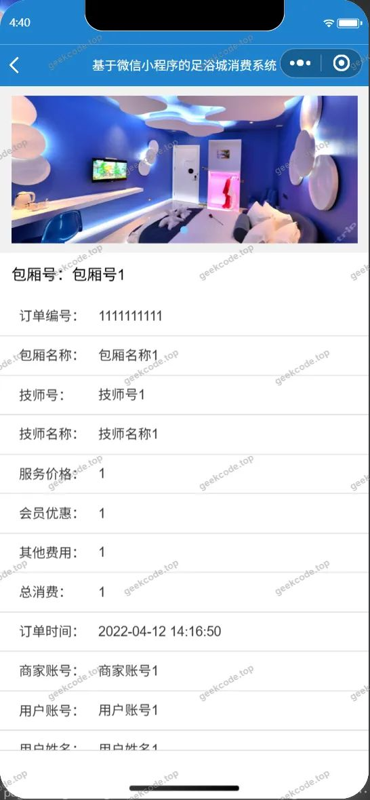</a><figcaption>小程序-项目订单详情</figcaption></figure>
<figure><a href="https://geekcode.top/archives/%E5%9F%BA%E4%BA%8E%E5%BE%AE%E4%BF%A1%E5%B0%8F%E7%A8%8B%E5%BA%8F%E7%9A%84%E8%B6%B3%E6%B5%B4%E5%9F%8E%E6%B6%88%E8%B4%B9%E7%B3%BB%E7%BB%9F?utm_source=github" title="查看完整源码">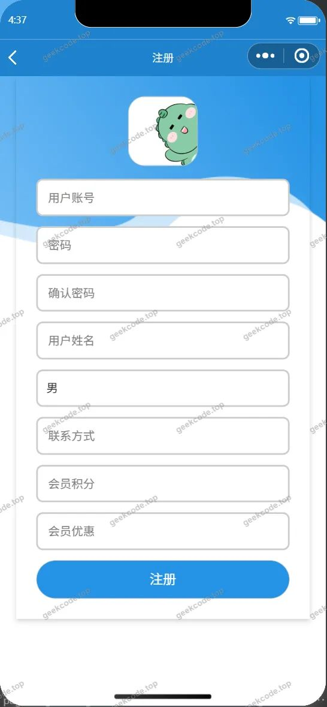</a><figcaption>小程序-注册</figcaption></figure>
<figure><a href="https://geekcode.top/archives/%E5%9F%BA%E4%BA%8E%E5%BE%AE%E4%BF%A1%E5%B0%8F%E7%A8%8B%E5%BA%8F%E7%9A%84%E8%B6%B3%E6%B5%B4%E5%9F%8E%E6%B6%88%E8%B4%B9%E7%B3%BB%E7%BB%9F?utm_source=github" title="查看完整源码">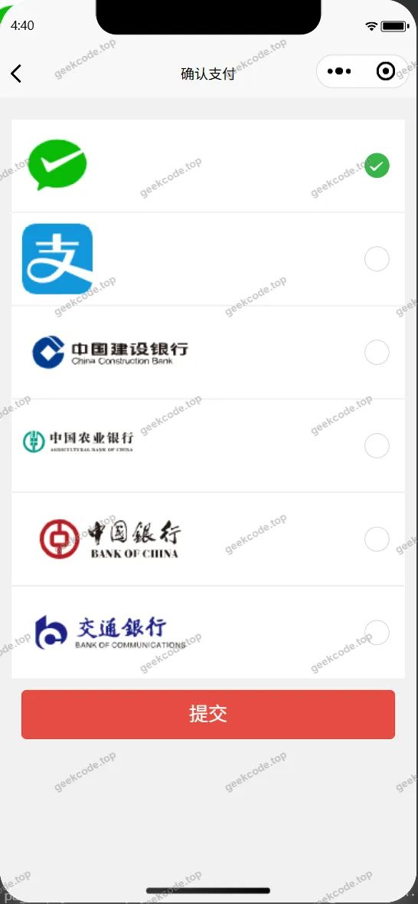</a><figcaption>小程序-payconfirm</figcaption></figure>

<h3>微信小程序管理端</h3>

<figure><figcaption>小程序-管理端-会员卡列表</figcaption></figure>
<figure><figcaption>小程序-管理端-会员卡详情</figcaption></figure>
<figure><figcaption>小程序-管理端-商家列表</figcaption></figure>
<figure><figcaption>小程序-管理端-商家详情</figcaption></figure>
<figure><figcaption>小程序-管理端-商品分类列表</figcaption></figure>
<figure><figcaption>小程序-管理端-用户列表</figcaption></figure>
<figure><figcaption>小程序-管理端-用户详情</figcaption></figure>

<h3>后台管理端</h3>
<h4>后台-包厢信息评论</h4>

<a href="https://geekcode.top/archives/%E5%9F%BA%E4%BA%8E%E5%BE%AE%E4%BF%A1%E5%B0%8F%E7%A8%8B%E5%BA%8F%E7%9A%84%E8%B6%B3%E6%B5%B4%E5%9F%8E%E6%B6%88%E8%B4%B9%E7%B3%BB%E7%BB%9F?utm_source=github" title="查看完整源码">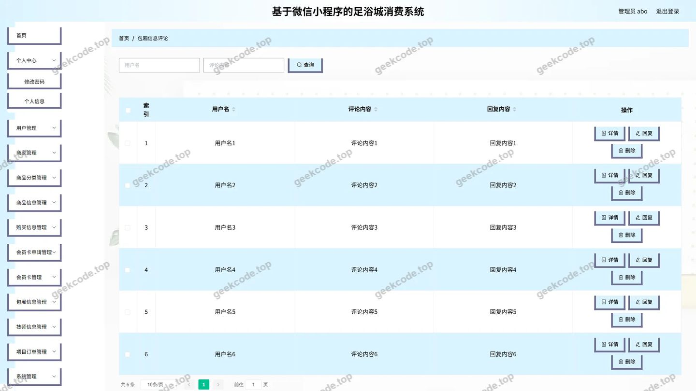</a>

<h4>后台-登录页</h4>

<h4>后台-公告资讯</h4>

<a href="https://geekcode.top/archives/%E5%9F%BA%E4%BA%8E%E5%BE%AE%E4%BF%A1%E5%B0%8F%E7%A8%8B%E5%BA%8F%E7%9A%84%E8%B6%B3%E6%B5%B4%E5%9F%8E%E6%B6%88%E8%B4%B9%E7%B3%BB%E7%BB%9F?utm_source=github" title="查看完整源码">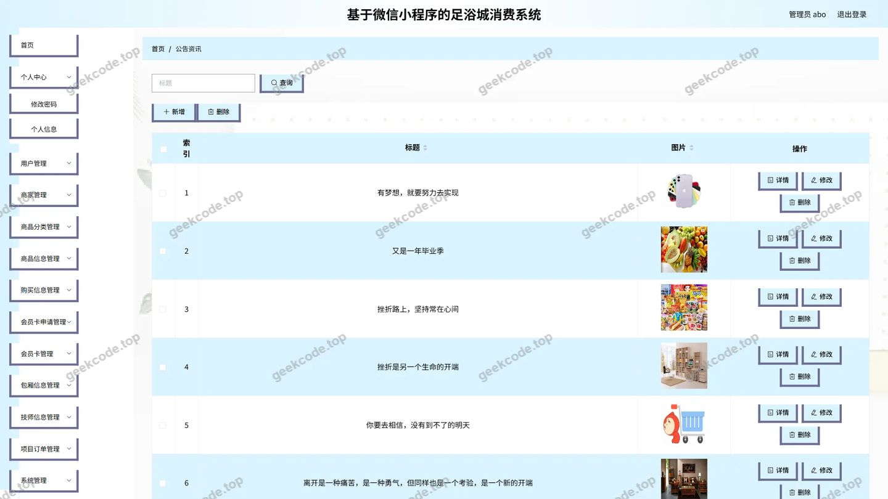</a>

<h4>后台-会员卡</h4>

<a href="https://geekcode.top/archives/%E5%9F%BA%E4%BA%8E%E5%BE%AE%E4%BF%A1%E5%B0%8F%E7%A8%8B%E5%BA%8F%E7%9A%84%E8%B6%B3%E6%B5%B4%E5%9F%8E%E6%B6%88%E8%B4%B9%E7%B3%BB%E7%BB%9F?utm_source=github" title="查看完整源码">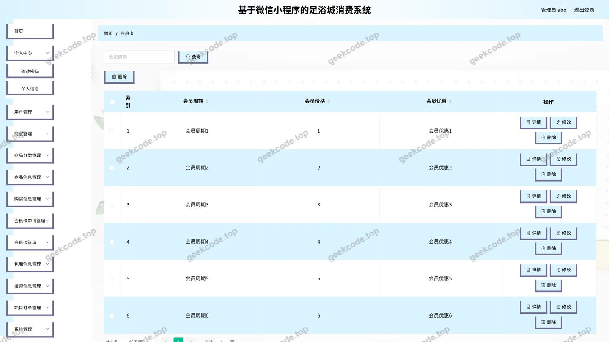</a>

<h4>后台-会员卡申请</h4>

<a href="https://geekcode.top/archives/%E5%9F%BA%E4%BA%8E%E5%BE%AE%E4%BF%A1%E5%B0%8F%E7%A8%8B%E5%BA%8F%E7%9A%84%E8%B6%B3%E6%B5%B4%E5%9F%8E%E6%B6%88%E8%B4%B9%E7%B3%BB%E7%BB%9F?utm_source=github" title="查看完整源码">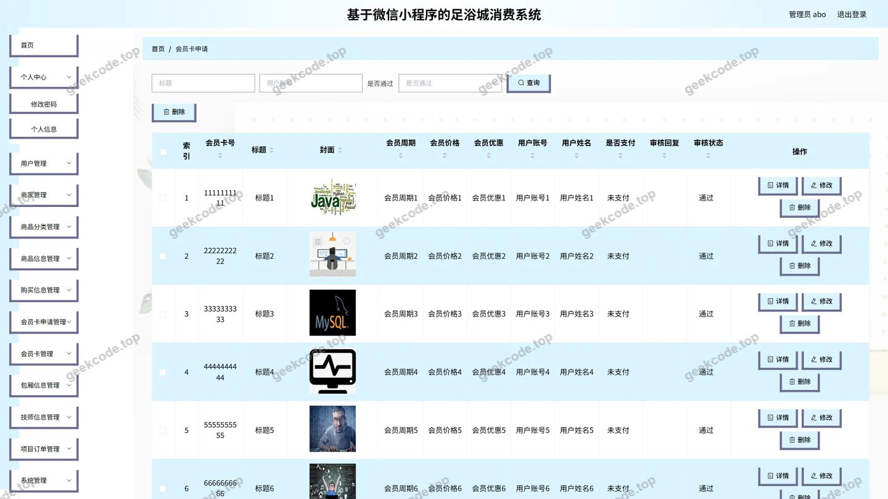</a>

<h4>后台-技师信息评论</h4>

<a href="https://geekcode.top/archives/%E5%9F%BA%E4%BA%8E%E5%BE%AE%E4%BF%A1%E5%B0%8F%E7%A8%8B%E5%BA%8F%E7%9A%84%E8%B6%B3%E6%B5%B4%E5%9F%8E%E6%B6%88%E8%B4%B9%E7%B3%BB%E7%BB%9F?utm_source=github" title="查看完整源码">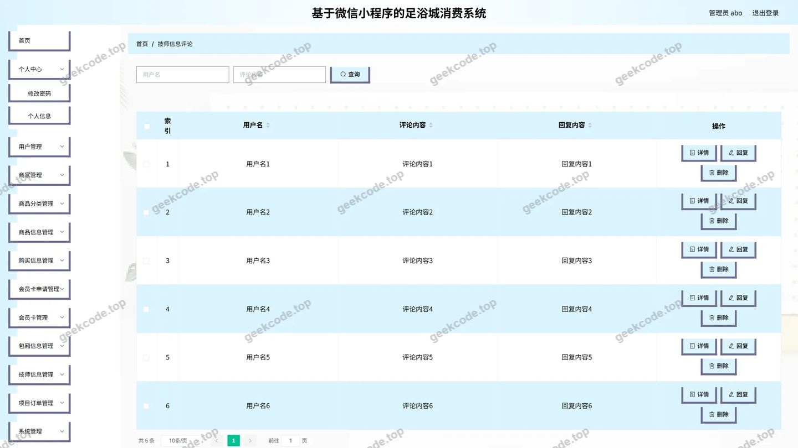</a>

<h4>后台-商品信息</h4>

<h4>后台首页</h4>

---

## 获取完整源码

| 项目 | 说明 |
| --- | --- |
| 项目名 | 基于微信小程序的足浴城消费系统 |
| 运行截图 | 本文 36 张（站点带水印原图，仓库 `images/` 目录） |
| 完整源码 | [https://geekcode.top/archives/%E5%9F%BA%E4%BA%8E%E5%BE%AE%E4%BF%A1%E5%B0%8F%E7%A8%8B%E5%BA%8F%E7%9A%84%E8%B6%B3%E6%B5%B4%E5%9F%8E%E6%B6%88%E8%B4%B9%E7%B3%BB%E7%BB%9F?utm_source=github](https://geekcode.top/archives/%E5%9F%BA%E4%BA%8E%E5%BE%AE%E4%BF%A1%E5%B0%8F%E7%A8%8B%E5%BA%8F%E7%9A%84%E8%B6%B3%E6%B5%B4%E5%9F%8E%E6%B6%88%E8%B4%B9%E7%B3%BB%E7%BB%9F?utm_source=github) |
| 咨询微信 | **ir9372**（备注：jingpin-yuanma） |
| 更多项目 | [极客代码 geekcode.top](https://geekcode.top/?utm_source=github) |

> 需要源码、部署、改配置、跑不起来等问题，加微信 ir9372 沟通，说明项目名即可。
